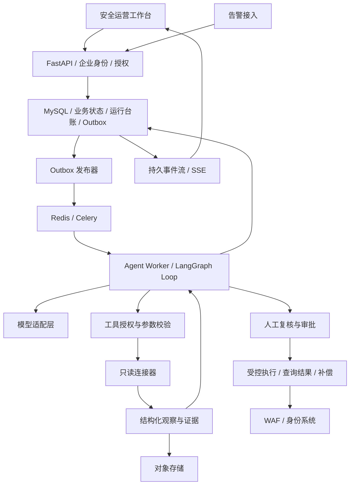

# 企业安全运营 Agent Loop 平台建设规格

日期：2026-10-17。状态：用户已确认范围并要求执行，已交付平台基础版本；下文保留完整目标规格，不代表所有生产准入项已完成。实际差距和验证以 `docs/platform-verification.md` 为准。

## 1. 已确认目标与设计假设

用户要求建设供企业使用、仅面向安全运营的 Agent Loop 平台。模型必须根据每轮工具反馈决定下一步，能够动态补查、调整调查方向、提交结论或请求人工接管。

保留告警、事件、证据、工单、复核、审批、执行、回查等业务对象。成功标准是可验证的动态调查闭环与企业运行保障，而不是给固定流程节点加上 Agent 名称。

本草案采用以下可调整的部署假设：一家企业独立部署，内部按组织、项目和资产权限隔离；不建设跨企业 SaaS 计费及租户运营系统。模型先通过企业批准的 API 接入。安全运营人员使用工作台，平台管理员维护模型与连接器配置。

尚未取得企业真实模型服务、SSO、WAF、日志平台与身份系统的接口资料或授权凭据。代码和测试环境可先建设；真实连接、容量指标与生产上线须有对应环境的验证记录，不以模拟测试代替。

## 2. 现有项目与目标差距

| 当前实现 | 企业目标 |
| --- | --- |
| `app/workflow.py` 固定 context → investigate → report | 模型决策与工具反馈形成有条件的循环 |
| 模型只生成可选摘要 | 模型动态选择工具、参数、补查方向和结束请求 |
| `app/tools.py` 从 fixture 返回模拟数据 | 参数化工具协议、权限校验、真实连接器、证据来源追踪 |
| SQLite 保存 JSON 事件 | MySQL 事务、独立运行记录、任务台账、执行台账、迁移与备份 |
| FastAPI BackgroundTasks 执行调查 | 独立 Worker、可靠投递、租约、故障恢复 |
| Cookie 中的演示角色 | 企业 SSO 身份、服务端角色及资产授权 |
| 重启后中断任务转人工 | 从已提交的运行边界恢复，并处理外部副作用的不确定状态 |
| 静态演示工作台 | 运行控制、实时轨迹、证据详情、审批中心、连接器管理 |

现有状态机、审批参数哈希、乐观版本校验与回归场景作为迁移基线保留；它们仍需扩展到真实身份和外部执行语义。

## 3. 架构选项与建议

1. **模块化 FastAPI 服务 + 独立 Agent Worker + 受控执行模块（建议）**：沿用 Python/LangGraph，业务数据库、队列和连接器边界清晰，可分别扩容 API 与 Worker，适合现有项目演进。
2. 按多个独立 Agent 服务拆分：增加跨服务身份、消息一致性、调度和故障定位成本；现阶段没有证明收益的需求。
3. 接入托管 Agent 平台：可减少部分运行时建设，但企业数据边界、采购和供应商约束尚不明确，不作为当前前提。

采用方案 1。初版为一个完整的调查 Agent loop；工具结果决定调查路径。多 Agent 协作在存在独立职责与验收收益时再增加。

## 4. Agent Loop 合约

每轮输入包括调查目标、事件摘要、授权工具定义、历史行动结果、证据引用、未解决问题和剩余预算。模型输出为以下三类之一：工具调用、候选最终报告、人工接管请求。

运行步骤：

1. Worker 获取运行租约，读取已提交快照，校验运行状态、授权、预算和配置版本。
2. 构造经过脱敏与长度限制的上下文，请求支持 tool calling 的模型。
3. 持久化模型返回的行动与调用 ID，校验工具名、参数 Schema、资产范围、风险级别及预算。
4. 执行允许的只读查询，记录工具结果、来源、完整性、错误分类与证据 ID；返回结果作为下一轮 observation。
5. 候选报告进入完成校验：引用必须存在且属于当前授权范围，结论必须符合场景所需证据规则；证据不满足则返回具体缺口继续补查。
6. 达到完成条件后等待人工复核；无权限、不可补齐的证据缺口或耗尽预算时转人工，保留已收集证据。

场景规则允许限制结论，例如“没有记录”不能等于“没有风险”，HTTP 200 不能证明攻击成功。规则不提前规定完整的工具调用顺序。

初始运行保护值建议：最多 12 次模型决策、24 次工具调用、300 秒主动运行时间；同一规范化工具参数连续两次无新结果时要求换路径，继续无进展则转人工。数值是可配置初值，需要通过评测调整。等待人工时间与主动运行时间分别统计。

Token 预算为每次运行的硬约束；调用前预留输入与最大输出预算，调用后核对 usage。费用在有已验证价格表时计算，否则显示未知，不伪造成本。429、超时等重试计入预算；模型不可用不静默改为规则流程并宣称完成 Agent 调查。

运行轨迹展示行动摘要、工具参数摘要、观察、证据引用、耗时与结束原因，不要求存储或展示模型私有思维链。

## 5. 工具、证据与上下文

工具元数据包含名称、版本、输入输出 Schema、只读或写入类型、授权要求、超时、结果大小上限、重试策略和凭据引用。Python 连接器为初始实现方式；MCP 是未来可选接入协议，不作为完成 Agent loop 的条件。

初始只读工具沿用资产查询、安全日志、认证日志、业务审计、授权核验、处置手册六类。支持时间窗、资产与账号等受控参数、分页及查询覆盖率；结果明确区分完整、部分、无匹配、无权限、超时和服务异常。

模型不得传入任意 SQL、Shell 或任意目标 URL。连接地址由管理员配置并验证，服务端注入数据范围，网络出口限制目标地址。查询和外部文档中的指令均作为数据处理。

每次调用生成独立 evidence_id；相同工具多次调用不覆盖旧证据。证据保留 source、query_scope、event_time、collected_at、coverage、content_hash 与原始附件引用。大结果分页或存入对象存储，模型获得有限片段和引用。上下文摘要保留来源链接，不能替代原始证据。历史事件和手册检索同样受资产与组织权限约束。

真实连接器与模拟连接器具有相同合约，但模式必须在配置、运行详情及报告中显示。production 模式禁止演示身份和模拟写操作，必需依赖缺失时 readiness 失败。

## 6. 持久化、调度与恢复

业务事实采用 MySQL；Redis 用于队列、缓存与短期通知。事务同时保存状态变化、审计和 Outbox，发布器可靠投递任务；消费者按 run_id、事件 ID 和运行版本去重。

新增逻辑实体：runs、run_steps、tool_calls、evidence、action_requests、approvals、executions、run_events、audit_events、outbox，以及身份映射、连接器配置和凭据引用。具体表结构与迁移脚本在实施计划中确定。禁止以 Redis 结果缓存作为审批或执行事实的唯一来源。

本方案选择**应用级轮次快照恢复**：每轮行动先落库，每次工具结果独立落库，下一轮仅从已提交记录重建。重启时复用成功结果，只读的未知结果可按策略重新查询。LangGraph 负责循环编排；不默认存在官方 MySQL checkpointer，不同时引入另一套未定义一致性规则的恢复系统。

租约带 fencing token；过期 Worker 的数据库提交必须拒绝。新 Worker 不能盲目重发处于执行中的写动作，先进入结果核对流程。Celery 的重投递不能被当作 exactly-once 保证。

Run 状态包括 queued、running、waiting_review、waiting_approval、waiting_input、completed、failed、cancelled、needs_attention。事件状态、Run 状态、外部动作状态分别管理。取消请求阻止新调用；已经提交到外部系统的动作仍需核对结果。

SSE 从持久 run_events 按序号输出；支持断线后的事件续取，断开浏览器不取消调查。运行日志和事件分页读取，避免每个客户端反复扫描全部事件表。

## 7. 真实身份、审批与执行

接入企业 OIDC SSO，使用 Authorization Code 流程，服务端会话；校验 state、nonce、issuer、audience、签名与有效期，处理 CSRF、会话过期和退出。用户不能自行提交角色获得权限。

岗位包括分析员、审批人、运维执行员、审计员与平台管理员；权限与组织、项目、资产范围共同决定可见数据和操作。提交人不能审批自己的高风险动作，即使拥有多个角色。

写工具从 Agent loop 生成 action_request，参数规范化后计算哈希并绑定申请人、目标、范围、有效期、连接器版本和运行版本。人工通过且执行时再次通过授权校验后才能执行。改参、过期、连接器版本变化或权限撤销必须重新评估或审批。

执行模块采用受限服务凭据。对支持幂等键的系统发送稳定 operation_id；对超时但可能已成功的调用标记 execution_unknown，查询外部状态或转人工，禁止盲目重试。没有幂等或状态查询能力的写连接器不得自动重放。

每种处置分别定义回查、到期解除与补偿方式。外部动作不可撤销时在审批界面明确展示。应用版本回滚不等于撤销封禁或账号冻结。

## 8. 工作台与运行保障

工作台提供事件队列、单次 Run 时间线、工具输入输出摘要、证据详情、报告与待核实项、运行停止/继续、人工补充信息、审批中心、执行结果与审计查询。管理员维护连接器健康状态、模型配置、预算及版本；凭据仅引用和轮换，前端不回显密钥。

观测覆盖 request_id、incident_id、run_id、tool_call_id；指标包含队列等待、运行耗时、模型错误、工具失败、人工接管率、预算终止、外部执行未知和审批积压。业务审计与调试日志分离，敏感内容脱敏，保存期限由企业政策配置。

部署需要 TLS、独立 API/Worker 进程、readiness/liveness、数据库备份与恢复演练、优雅停机、依赖故障告警和发布回退。实际并发、P95、RPO/RTO 在企业容量和恢复要求确定后形成准入记录，不在缺乏测量时声明达标。

## 9. 拟采用的技术与变更边界

| 能力 | 选型 |
| --- | --- |
| API / 校验 / 连接器 | 保留 Python 3.12、FastAPI、Pydantic、HTTPX |
| Agent loop | 保留 LangGraph，使用模型 tool calling 与自定义受控工具执行 |
| 模型 | 企业批准且通过 tool calling 合约测试的 Qwen 或兼容模型 API，模型 ID 外部配置 |
| 事务与迁移 | MySQL、SQLAlchemy、Alembic，替换生产 SQLite 路径 |
| 调度 | Celery、Redis；应用事务 Outbox 与执行台账 |
| 证据附件 | 企业对象存储，通过适配器接入 |
| 登录 | 企业 OIDC SSO；Keycloak 可用于集成测试 |
| 工作台 | 第一阶段扩展现有前端；复杂度和维护需求验证后单独评估 Vue 3/TypeScript 迁移 |
| 实时与观测 | SSE、结构化日志、OpenTelemetry，接入企业指标与日志平台 |
| 交付 | Docker、Compose 集成环境、企业已有部署平台和 CI/CD |

新增依赖和数据库结构是达到目标的计划变更，实施时锁定版本并验证兼容性，不借机升级全部依赖。当前 LangGraph 固定为 1.1.6，官方在线文档可能描述更新 API；实施以安装版本及对应测试为准，不直接使用需要新版本的接口。

现有告警 API 尽量兼容；新增 run、审批和管理接口按版本管理。旧 SQLite 数据先备份，通过显式导入命令迁移并验证记录数、关联和审计，不在启动时删除或重写用户数据。当前目录未发现 Git 仓库，实施前需要建立可回退的版本管理或源码备份。

## 10. 分阶段交付与验收

阶段划分服务于完整平台交付，任何单阶段完成均不等于平台已可上线。

| 阶段 | 交付内容 | 验收门槛 |
| --- | --- | --- |
| A：动态调查内核 | 真正模型驱动循环、参数化工具、预算、完成校验与轨迹 | 不同观察导致不同后续调用；多轮补查；非法调用与无进展循环被处理；模型不可用明确失败或接管 |
| B：企业运行底座 | MySQL、Worker、Outbox、运行快照、SSO、资产授权 | 重启恢复；重复任务去重；越权拒绝；状态和审计一致；批准的身份不能被前端伪造 |
| C：安全运营闭环 | 真实只读连接器、报告复核、受控写操作、外部状态回查 | 至少一个真实数据源完成查询验证；一个写连接器在授权测试环境验证审批、幂等、超时核对和补偿 |
| D：上线交付 | 工作台、监控、CI、部署、备份与故障演练 | 模型实测、端到端测试、容量报告、权限测试及恢复演练通过，并记录外部环境依赖 |

自动化验收至少覆盖：

- 同一告警因工具结果不同走出不同调查路径；工具参数由模型提出，经服务端校验。
- 调用工具后模型获得对应 tool_call_id 的 observation，能够追加查询、改变参数或结束。
- 报告不能引用不存在或无权访问的证据；证据不足时不能默认关闭事件。
- 超时、429、坏 JSON、未知工具、超大结果、重复调用、预算耗尽、取消均有确定状态和审计。
- Worker 在决策提交前后、工具调用前后、结果保存前后中断，恢复行为可重复验证。
- 重投任务和审批恢复不重复产生外部副作用；未知结果进入核对而非自动重发。
- 跨组织、跨资产读取、工具调用、报告导出和 SSE 均受权限约束。
- 未审批、审批过期、参数变化、自批、权限撤销及模拟模式混入 production 被拒绝。
- 保留当前五类安全场景的业务约束；新增路径测试不依赖模型固定措辞。
- 自动测试使用 scripted model 和 fake connector 保证可重复；另有真实模型集成评测，二者在验证报告中分别列出。

## 11. 本次规格的验证与参考

本次仅检查源码、配置、既有测试与设计文档，并编写规格；未运行应用测试，未修改产品代码，未进行真实模型或企业接口连接。已有 Demo 验证记录不能用于证明本规格已经实现。

官方资料用于核对持久化、消息重投递与身份接口概念；实现时仍需依据锁定版本验证：

- LangGraph persistence：https://docs.langchain.com/oss/python/langgraph/persistence
- LangGraph interrupts：https://docs.langchain.com/oss/python/langgraph/interrupts
- Celery Redis：https://docs.celeryq.dev/en/stable/getting-started/backends-and-brokers/redis.html
- OIDC 集成参考：https://www.keycloak.org/securing-apps/oidc-layers

实施进度：已按用户“执行”开展建设，详见实施计划与平台验证记录。阶段 A/B 已有代码及本地/容器验证，C/D 中的真实接入、浏览器验收、企业容量和完整恢复仍待验证。不得仅调整项目名称、简历描述或界面标签便宣称完成企业生产平台。
