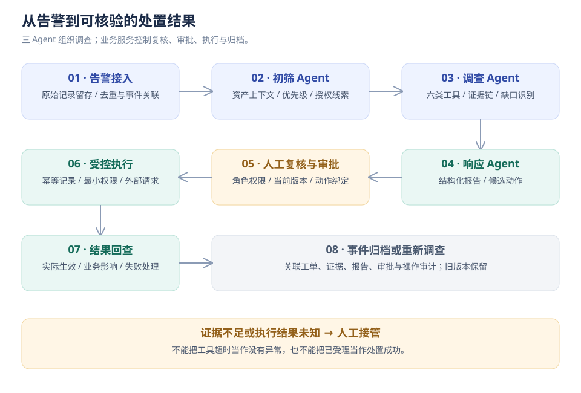
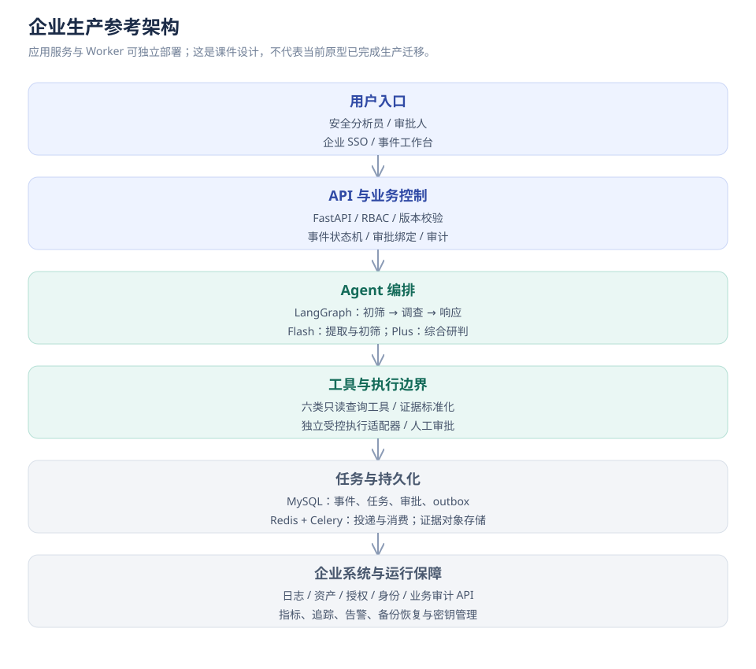
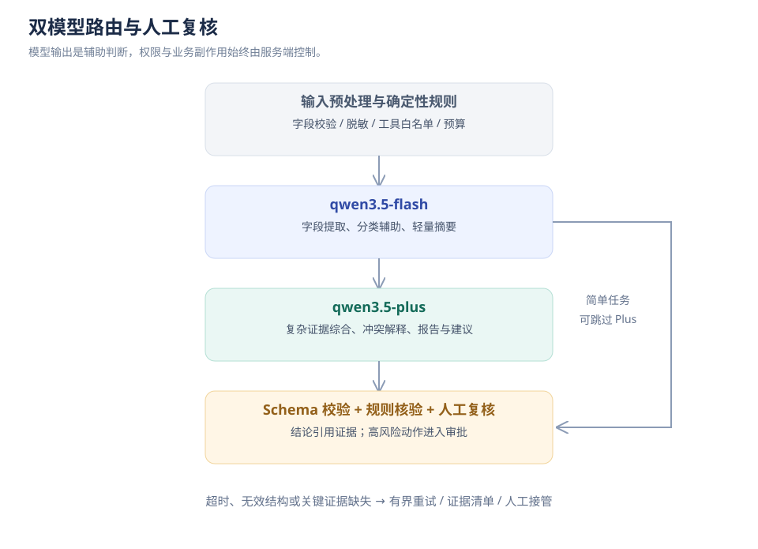
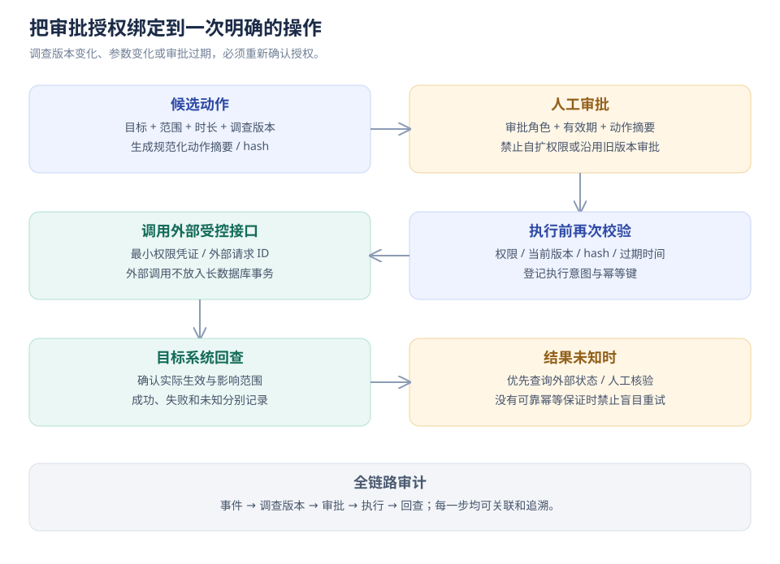
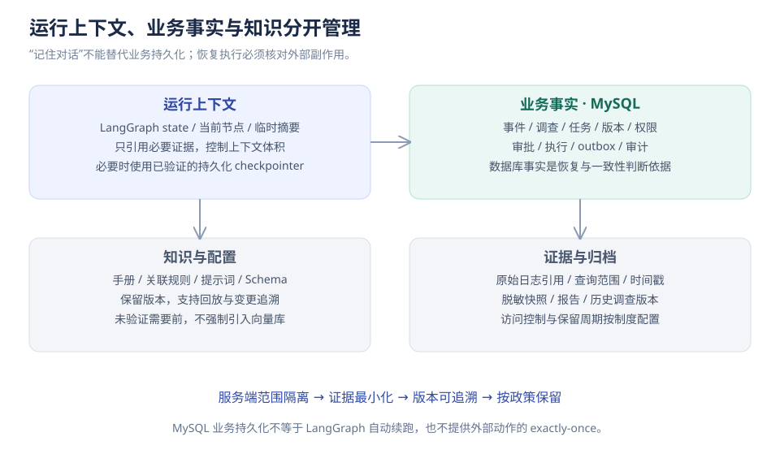
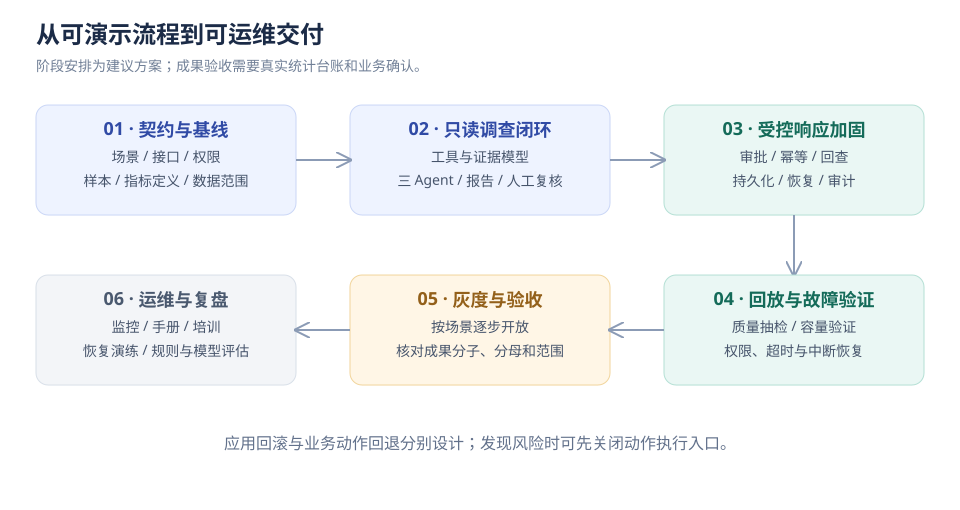

# 电商安全运营智能研判与响应协同平台

**广州臻亿电子商务有限公司 · 项目介绍课件**  
项目周期：**2026.04—2026.10**　｜　岗位：**Agent 开发工程师**　｜　团队：**6 人**

> **阅读说明**：本课件以用户提供的项目介绍、四项主要职责、三项实现成果为主线，参照“第49个场景”的七章结构展开。业务事实和成果由用户提供；为说明完整落地方式而补充的生产架构、容量与团队分工属于设计方案。统计周期、样本量等缺失信息集中列在附录。本文不将当前原型代码等同于全部生产实现。

## 一、项目背景

### 1.1 所属行业与项目定位

所属行业为电子商务，项目服务于企业内部安全运营团队，覆盖订单、支付、用户服务和运营后台的安全事件调查与响应协同。它承接既有安全产品产生的告警，将分散的查询、人工判断、审批和处置组织成可跟踪的业务流程。

项目定位是 **Agent 辅助调查 + 业务规则控制 + 人工决策 + 受控执行**。WAF 负责检测和拦截请求，身份系统负责账号与会话，日志平台保存原始记录；本平台组织这些系统之间的证据和操作，形成完整事件档案。

### 1.2 为什么做这个项目

订单接口出现攻击告警时，分析员通常还要查询防护动作、应用执行记录、资产负责人及授权扫描记录，才能判断是否需要处置。运营账号发生异常登录后，也需要继续核对会话、权限和导出任务，确认是否触及客户数据。

这些信息分散在多个系统。人工调查不仅需要来回切换控制台，还容易遗漏查询范围、混淆请求成功和业务操作成功。处置时又涉及安全、业务和运维团队，审批意见与执行结果若只保存在聊天记录里，后续很难复盘。

因此，本项目将调查方法沉淀成 Agent 工作流，将关键判断和操作沉淀成状态机，让安全人员从重复收集信息转向证据核验与风险决策。

### 1.3 业务痛点与解决路径

| 痛点 | 电商场景中的表现 | 项目解决路径 |
| --- | --- | --- |
| 告警多且重复 | 同一来源持续请求订单接口，形成大量相似告警 | 先去重、关联，再形成调查事件；保留原始告警映射 |
| 调查跨系统 | WAF、应用审计、登录日志、资产和授权记录分别查询 | 统一工具适配与结构化证据，自动收集并关联 |
| 结论容易混淆 | HTTP 200 被误认为注入成功；WAF 拦截被当作误报 | 分别输出行为性质、防护结果、业务影响 |
| 处置协作不透明 | 不清楚谁审核、谁批准、是否实际执行成功 | 事件状态机、具体人员身份、审批与执行记录关联 |
| 处置后缺少验证 | 接口返回成功就直接关闭事件 | 查询外部真实状态与后续日志，回查通过后关闭 |
| 经验难以复用 | 调查路径依赖个别资深分析员 | 版本化工具、规则、手册和报告模板，持续复盘 |

### 1.4 项目价值与实现成果

| 成果维度 | 项目成果 | 严格口径 |
| --- | --- | --- |
| 告警研判效率 | 高优先级告警人工初筛 **60 分钟→15 分钟，降低75%** | 指人工初筛，不是模型延迟，也不包含完整审批和处置 |
| 重复调查工作量 | 去重聚合后待处理事件量 **减少约30%** | 指相同统计范围下的处理量变化，不等于攻击量或误报率下降 |
| 自动化处置覆盖 | **80%的事件包含自动化处置步骤** | 允许保留人工审批；不代表80%的事件无人参与、全自动关闭 |

以上为用户指定的项目成果。统计周期、样本数、耗时起止事件和测量材料尚待补充，详见第六章。课堂演示中的虚构样例数只用于说明计算，不作为项目实测量。

### 1.5 目标用户与责任边界

| 用户 | 使用目的 | 可执行职责 | 关键限制 |
| --- | --- | --- | --- |
| 安全分析员 | 了解事件、核验证据、判断风险 | 发起调查、复核报告、申请处置、回查 | 不能替代负责人批准自己的高风险操作 |
| 安全负责人 | 管理风险和处置范围 | 审批或驳回明确的操作方案 | 审批绑定目标、范围、有效期和版本 |
| 运维执行员 | 执行批准的操作并跟踪结果 | 提交执行、确认外部状态、按批准方案恢复 | 无权直接修改处置目标后沿用原审批 |
| 业务资产负责人 | 判断业务影响和授权情况 | 确认扫描、导出任务、业务窗口 | 只访问授权业务域的事件与证据 |
| 审计查看者 | 复盘处理过程 | 只读查阅、受控导出 | 不拥有审批或执行权限 |

### 1.6 业务流程总览



**讲解要点**：告警产生后先组织证据，人工复核后再决定是否处置。授权或误报可以进入核验归档；证据不足保持开放；恶意活动走审批执行。所有路径都保留原始证据和处理依据。

### 1.7 项目边界

- 处理接口攻击、异常账号、敏感导出、授权活动核验和证据缺失；支付接口安全不等同于支付交易反欺诈。
- 不把日志平台、WAF 和身份系统全部重建；通过受控接口调用既有能力。
- 公司营收、订单量、用户量和实际设备品牌未提供，不从公司名称推断。
- 企业内部按业务域、资产和人员授权隔离；无需为了“企业级”强行引入外部客户多租户模式。

## 二、简历上的项目

### 2.1 可直接整理到简历的项目介绍

**项目名称：电商安全运营智能研判与响应协同平台**  
**所属公司：广州臻亿电子商务有限公司**  
**项目时间：2026.04—2026.10**  
**项目角色：Agent 开发工程师｜团队规模：6 人**

**项目介绍：** 面向公司订单、支付及运营后台的安全运营需求，针对接口攻击告警分散、异常账号行为调查依赖人工、处置过程缺乏统一追踪等问题，建设多 Agent 安全研判与响应协同平台。通过关联安全日志、资产信息、账号行为和业务授权记录，生成结构化证据链与调查报告，结合人工复核、审批处置和结果回查，实现安全事件全生命周期管理，为交易系统与客户数据安全提供支撑。

**主要工作：**

1. **多 Agent 工作流开发：** 基于 LangGraph 构建初筛、调查与响应三个 Agent，编排资产上下文补全、安全日志查询、授权核验及报告生成流程，实现调查过程与工具调用可追踪。
2. **证据关联与智能研判：** 统一封装六类查询工具，设计结构化证据模型，结合确定性规则和 LLM 辅助摘要，分别评估攻击性质、防护结果及业务影响，支持证据缺失识别与人工接管。
3. **事件流转与处置控制：** 设计覆盖调查、复核、审批、执行及回查的状态机，通过角色权限、乐观版本校验、审批参数哈希绑定和幂等控制，保障处置流程的一致性与可追溯性。
4. **数据持久化与审计：** 实现事件档案、关联工单、审批及执行记录持久化，通过数据库事务保证业务状态与审计记录一致，支持中断调查处理、重新调查和历史证据保留。

**项目成果：**

1. 面向订单接口攻击、运营账号异常及敏感数据导出场景，实现多源证据自动关联与调查摘要生成，将高优先级告警人工初筛耗时由 **60 分钟缩短至15 分钟，降低75%**。
2. 建立基于攻击来源、目标资产及时间窗口的关联告警聚合机制，统一事件管理与证据归档，使去重聚合后的待处理事件数量**减少约30%**。
3. 打通事件研判、人工审批、处置执行及结果回查流程，使**80%的事件包含自动化处置步骤**，高风险动作保留人工审批与操作审计。

**技术栈说明：** 核心为 Python、FastAPI、LangGraph、Pydantic、HTTPX、SSE、Docker，模型为 qwen3.5-plus / qwen3.5-flash。课件生产参考方案采用 MySQL、Redis/Celery；原型使用 SQLite。正式简历技术栈应与实际采用的组件保持一致。

### 2.2 四项职责如何讲清楚

| 职责 | 面试时展开的实现细节 | 可以出示的材料 |
| --- | --- | --- |
| 工作流 | 输入状态、节点职责、证据缺口分支、停止条件、重试边界 | 节点图、运行轨迹、失败样例 |
| 证据研判 | 查询范围、来源关联、时间线、结论引用、冲突处理 | 脱敏证据 Schema、报告样例、评测记录 |
| 事件控制 | 谁可以操作、从哪个状态进入、审批为何失效、重复请求如何处理 | 状态迁移表、权限矩阵、幂等测试 |
| 持久化审计 | 事务边界、版本号、任务中断、外部执行状态未知 | 表结构、事务伪代码、恢复演练记录 |

### 2.3 一分钟项目讲解

“我在广州臻亿电子商务有限公司负责一个电商安全运营 Agent 项目，项目周期是2026年4月到10月，团队6人，我的岗位是Agent开发工程师。业务上主要处理订单接口攻击、运营账号异常和客户数据导出等事件。以前分析员要跨多个系统查日志、找负责人、核对授权，我们把这些步骤组织成LangGraph工作流，由初筛、调查、响应三个Agent协作，输出有证据引用的报告。我的工作集中在工作流、六类查询工具、事件状态机和持久化审计。高风险操作要经过人工复核与审批，执行后还要回查。项目成果分别是人工初筛60分钟降到15分钟、聚合后待处理事件量减少约30%、80%的事件包含自动化处置步骤。”

### 2.4 三分钟深入讲解

讲解顺序为“业务问题 → 一条事件链 → 我的实现 → 异常处理 → 指标”。不要逐个背技术名词。

以订单接口注入告警为例：先补全资产与授权信息，再查询WAF和应用审计，判断攻击行为是否成立、是否被拦截、是否存在业务影响。Plus整理复杂证据，Flash做轻量分类和字段提取，最终结论经过规则检查和人工复核。复核恶意后生成具体处置方案，负责人审批，执行服务再检查参数哈希和有效期。外部调用超时会先查执行状态，不直接重复封禁。回查通过才能关闭事件和工单。

个人贡献回到四个点：图节点与分支如何组织、工具结果如何规范、审批执行如何约束、状态与审计如何一致。成果只讲三个已给出的指标，不临时增加未经统计的准确率、QPS或可用性。

### 2.5 根据岗位侧重点调整表达

| 面试方向 | 重点讲什么 | 仍需遵守的事实边界 |
| --- | --- | --- |
| Agent 应用开发 | 模型分工、结构化输出、工具路由、证据引用与降级 | 不把路由模型算作第四个业务Agent；不宣称未经评测的准确率 |
| Python 后端 | 事务、状态机、权限、幂等、异步任务与API | 只讲自己实际负责或参与的组件 |
| 方案与架构 | 业务边界、外部系统对接、失败处理、容量与运维 | 将课件设计与真实部署清单分开说明 |

## 三、项目的附带信息

### 3.1 规模、数据来源与容量基线

| 项目项 | 本课件采用的数值或范围 | 性质 |
| --- | --- | --- |
| 团队人数 | 6人 | 用户确认 |
| 业务Agent | 3个 | 用户职责与原型结构 |
| 查询工具 | 6类 | 用户职责与原型结构 |
| 核心演示场景 | 5类 | 原型场景；生产场景按同类业务展开 |
| 日均原始告警 | 5,000条/日 | **容量设计基线，不是公司实测** |
| 大促压力演练 | 25,000条/日等效量，另构造突发流量 | 5倍日量为设计假设，不代表已通过压测 |
| 聚合后事件量 / Agent任务量 | 根据实际聚合规则与分流策略统计 | 待补充，不由原始告警量直接推算 |
| 统计周期、样本数 | 尚未提供 | 待补充 |

容量参考了Sitecore公开的每周最多45,000个安全事件案例；其单位与本课件的“原始告警”不同，因此5,000条/日只是为技术方案选定的设计基线，不是直接换算出的客户数据。[Sitecore案例](https://www.paloaltonetworks.com/customers/sitecore-achieves-90-percentage-soc-automation-with-cortex-xsoar)

5,000÷86,400约为0.058条/秒，这只是全天均值。真实压力可能来自集中补采、大促攻击突发和下游限流，不能据此宣称系统仅需0.058 QPS。压测分别测接入吞吐、队列积压、工具并发和模型配额。

### 3.2 企业生产参考架构



| 层次 | 选型与组件 | 职责 |
| --- | --- | --- |
| 交互入口 | Web工作台、企业SSO、HTTPS反向代理 | 登录、事件详情、审批、审计导出 |
| API与业务服务 | FastAPI、Pydantic、RBAC+资产范围校验 | 状态迁移、参数验证、版本控制、审计 |
| 调查编排 | LangGraph、三个业务Agent、模型路由函数 | 收集证据、有限补查、生成报告 |
| 模型服务 | qwen3.5-flash、qwen3.5-plus，统一模型网关 | 结构化分类与提取、复杂证据归纳 |
| 异步执行 | Celery Worker、Redis队列、MySQL任务台账与Outbox | 投递、重试、租约、超时与恢复 |
| 数据持久化 | MySQL、对象存储；Redis缓存短期状态 | 业务事实、审计、证据文件、状态通知 |
| 外部连接器 | WAF、日志平台、身份系统、资产台账、授权工单 | 只读查询与受审批约束的操作 |
| 运行保障 | 指标监控、结构化日志、链路追踪、备份恢复 | 发现故障、定位慢节点、核对任务与外部状态 |

**设计取舍**：先保持一个清晰的业务服务与独立Worker，避免把每个Agent拆成微服务。业务表以MySQL为事实来源；Redis不能独自承担审批和执行记录的持久化。当前课件不要求新增MCP/A2A服务，只有跨团队工具共享或跨服务Agent协作确有需求时再引入协议层。

### 3.3 主模型与轻量模型分工

| 模型 | 本项目职责 | 输入 / 输出 | 不承担什么 |
| --- | --- | --- | --- |
| qwen3.5-flash | 事件类别判断、实体字段提取、查询任务路由、短文本摘要 | 脱敏告警 → 受Schema约束的分类、IP/账号/资产/时间窗口 | 不决定授权、不直接执行封禁 |
| qwen3.5-plus | 复杂证据关联、矛盾解释、影响分析、报告和处置建议 | 结构化证据包 → 带证据ID的结论草稿、缺口和建议 | 不修改审批、不能越过工具策略 |
| 确定性规则 | 完整性门槛、授权范围、权限、参数有效性、状态迁移 | 明确字段 → 可复现判断 | 不依赖模型自报置信度证明安全 |

官方产品页确认两种型号支持Function Calling和结构化输出。这里的具体职责分配是本项目设计；“Flash”作为轻量分工角色，并不意味着已经确认某个B级参数量。[Plus官方资料](https://help.aliyun.com/zh/model-studio/qwen3-5-plus)、[Flash官方资料](https://help.aliyun.com/zh/model-studio/qwen3-5-flash)

**参数量与部署口径**：采用阿里云百炼托管API，应用选择模型ID、地域、版本、配额和请求预算。已查阅的上述官方产品页未披露可核实的总参数量与激活参数量，课件不写“Plus=某B、Flash=某B”。模型权重规模也不是调用方可配置的参数。

为理解MoE，可参考官方开源型号Qwen3.5-397B-A17B（总参数397B、激活17B）和Qwen3.5-35B-A3B（总参数35B、激活3B）。这些是**不同的开源权重型号**，本课件不据此断言两个托管API的底层参数，也不将它们列为本项目自部署模型。[官方397B模型卡](https://huggingface.co/Qwen/Qwen3.5-397B-A17B)、[官方35B模型卡](https://huggingface.co/Qwen/Qwen3.5-35B-A3B)

### 3.4 模型路由、降级与数据边界



1. 首先由代码解析已知格式；能确定的字段不重复调用模型。
2. Flash只处理允许的分类与提取任务，输出必须通过Pydantic/JSON Schema校验。
3. 存在证据矛盾、影响判断复杂或多系统关联时，组织证据包交给Plus；不把整库日志直接塞进上下文。
4. 若输出缺字段、引用不存在或模型不可用，返回规则生成的报告骨架与缺口，必要时转人工。
5. 模型只能提出受限工具请求；执行器验证操作者、资产范围、参数Schema和剩余调用预算后才调用。

调用前去除密钥、Cookie、Token和非必要客户明细；保留可关联的脱敏账号ID、trace_id、时间戳和必要业务字段。访问地域和数据是否允许出域需由企业确认。鉴权信息留在服务端，不进入Prompt或审计正文。

### 3.5 三个Agent详细说明

| Agent | 主要输入 | 具体动作 | 交付结果 |
| --- | --- | --- | --- |
| TriageAgent | 标准化事件、资产与时间窗 | 补全资产负责人、业务重要性；核验授权范围；给出缺失查询项 | 上下文包、授权状态、调查范围 |
| InvestigationAgent | 上下文包、候选工具任务 | 关联安全、认证与业务审计；建立时间线；识别缺失与冲突 | 证据列表、覆盖范围、候选结论 |
| ResponseAgent | 已收集证据、候选结论、处置手册 | 整理证据引用、建议措施与回查条件；输出结构化报告 | 待复核报告与处置建议 |

三个Agent是职责边界，模型可以复用。不能把“三个Agent”理解成必须有三套独立模型或三个常驻进程。ResponseAgent产出的建议不等于执行授权。

### 3.6 六类查询工具清单

| 工具 | 查询对象与用途 | 关键参数 | 关键返回字段 | 主要使用者 |
| --- | --- | --- | --- | --- |
| asset_context | 资产台账、负责人、业务域 | asset_id、environment | owner、business_scope、criticality | TriageAgent |
| authorization | 扫描/变更/导出授权记录 | source、asset_id、time_range | authorized、scope_matches、within_window、record_id | TriageAgent |
| security_logs | WAF/网关安全请求与防护动作 | asset_id、source_ip、time_range、cursor | rule、final_action、request_id、trace_id | InvestigationAgent |
| auth_logs | 认证、会话与账号异常 | account_id、time_range | login_result、mfa、session_id、source | InvestigationAgent |
| business_audit | 应用执行、导出任务及敏感操作 | trace_id/account_id、time_range | operation_result、export_job_id、coverage | InvestigationAgent |
| playbook | 经审核处置手册与版本 | scenario、asset_type、version | steps、approval_policy、verification_checks | ResponseAgent |

**六类只读查询工具与写操作分离。** 生产补充的block_ip、freeze_account、revoke_session、query_action_status等执行连接器由受控执行服务调用，不混入六类查询工具数量，也不允许模型自由访问。

### 3.7 外部系统对接方式

以业务审计查询为例，先与系统负责人确认接口文档、授权方式、时间字段、分页方式及日志覆盖延迟。适配器完成认证、超时、分页和字段映射，向Agent返回统一证据格式。

| 环节 | 设计要求 |
| --- | --- |
| 身份 | 按系统配置服务账号，优先只读权限；密钥由凭据管理服务提供 |
| 范围 | 服务端填充允许资产范围；模型传入asset_id不能扩大授权 |
| 时间 | 保存源时区并统一转换；记录event_time与ingested_at，考虑延迟入库 |
| 分页 | 保存游标、页数与查询范围；达到上限应标注partial，不能当作全部完成 |
| 错误 | 区分无数据、无权限、超时、限流、结构变化；保留错误码和可重试性 |
| 性能 | 限制并发、设置请求预算和熔断；按来源独立控制，避免拖垮业务系统 |
| 可追踪 | 保存request_id、run_id、查询条件摘要和返回内容哈希 |

**接口样例为设计示意，不是公司真实域名：**

```text
GET /audit/events?account_id=ACCOUNT_DEMO&start=...&end=...&cursor=...
输入约束：调用者可访问资产；时间窗有上限；仅允许预定义过滤条件
输出约束：records、next_cursor、coverage、source_request_id、query_status
失败语义：timeout / forbidden / rate_limited / partial / schema_changed
```

### 3.8 结构化证据与研判规则

```json
{
  "evidence_id": "EV-DEMO-001",
  "incident_id": "INC-DEMO-001",
  "run_id": "RUN-DEMO-02",
  "source": "business_audit",
  "query_scope": {"asset_id": "order-api", "time_range": "示例时间窗"},
  "query_status": "complete",
  "coverage": {"has_more": false, "missing_fields": []},
  "facts": [{"trace_id": "TRACE-DEMO", "operation_result": "rejected"}],
  "content_hash": "示例：证据内容的SHA-256摘要",
  "collected_at": "示例采集时间"
}
```

| 研判维度 | 取值示例 | 证据要求 |
| --- | --- | --- |
| 行为性质 | malicious / authorized / false_positive / inconclusive | 攻击特征、有效授权、人工复核依据 |
| 防护结果 | blocked / passed / mixed / unknown | 具体防护动作与其覆盖的请求范围 |
| 业务影响 | confirmed / not_observed / unknown | 实际业务执行结果；“未发现”必须附查询范围 |

**优先规则**：关键证据不完整时保持待核实；授权必须同时匹配来源、范围和时间；HTTP 200不能单独证明攻击成功；恶意请求被WAF拦截也仍可能属于恶意活动。多源证据冲突时，将相互矛盾的事实并列展示，不能让模型凭语气确定哪个是真的。

### 3.9 告警去重、事件聚合与任务路由

接入首先使用“来源系统+源告警ID”保证重复推送不重复入库。没有稳定ID时，计算规范化载荷指纹，并记录可能碰撞与人工拆分入口。随后按来源、资产、攻击类别、账号和时间窗口进行业务聚合；不同业务域不能仅因共享IP就合并。

建议的关联键为business_scope + asset_id + principal/source_ip + attack_family + window。时间窗、迟到事件处理和跨窗口合并策略需通过历史样本验证，不在未评估时固定为全场景通用值。

| 任务类型 | 路由 | 停止/转人工条件 |
| --- | --- | --- |
| 接口攻击调查 | Triage → Investigation → Response | 应用日志缺失或范围不明 |
| 账号敏感操作 | 增加auth_logs和导出任务关联 | 身份归属冲突、账号确认缺失 |
| 授权扫描核验 | 优先authorization并交叉验证资产 | 授权过期、范围不符、来源不符 |
| 补充证据 | 只补查缺失项，建立新运行版本 | 超出预算、来源不可访问 |
| 处置回查 | 受控状态查询与后续审计 | 措施未生效、残留风险、无法核实 |

误聚合会掩盖风险，应保留原始告警清单、支持拆分事件，并将误合并率列入抽检。处理量下降必须与质量指标一起观察。

### 3.10 事件状态机与权限控制

| 当前状态 | 操作 | 下一状态 | 必要条件 |
| --- | --- | --- | --- |
| new / needs_attention | 开始或重新调查 | investigating | 角色与资产权限正确，版本匹配 |
| investigating | 调查完成 | pending_review | 报告与证据已持久化 |
| pending_review | 复核恶意 | awaiting_approval | 人工判断、具体措施、责任归属 |
| pending_review | 复核授权/误报 | awaiting_verification | 支撑结论的完整证据 |
| pending_review | 证据不足 | needs_attention | 工单保持打开，列出缺口 |
| awaiting_approval | 批准 / 驳回 | ready_to_execute / pending_review | 指定审批人、参数版本绑定 |
| ready_to_execute | 执行请求 | executing | 有效审批、幂等键、执行租约 |
| executing | 确认结果 | awaiting_verification / execution_unknown | 外部结果明确；未知结果进入对账 |
| execution_unknown | 查询外部状态 | awaiting_verification / needs_attention | 禁止盲目重复写操作 |
| awaiting_verification | 回查通过 | resolved | 措施或归档依据有效、工单同步关闭 |

executing和execution_unknown是生产补充状态，原型仅保留简化执行路径。前端按钮只是交互提示，真正的角色、身份、资产范围和版本判断必须在服务端执行。

### 3.11 审批、幂等与外部执行



审批绑定incident_id、action_version、规范化参数哈希、申请人、审批人、有效期及审批策略版本。参数变化后必须重新批准。申请人和审批人按具体人员ID分离，不能只验证两个角色名称不同。

执行服务用action_id作为稳定幂等键，通过唯一约束阻止并发创建多条相同执行。先提交“准备执行”的记录，再调用外部系统，随后保存外部请求ID和结果。数据库事务不跨越外部HTTP调用，避免长事务与虚假的跨系统原子性。

若外部系统支持幂等键，重复调用必须复用同一个键；不支持时，先通过目标状态或外部任务ID对账。超时不能直接等于失败，也不能直接等于成功。需要撤销或恢复时，使用预先批准的到期恢复策略或独立审批，并验证恢复结果。

### 3.12 持久化、记忆与审计



| 数据对象 | 保存内容 | 关键约束 |
| --- | --- | --- |
| incidents / incident_alerts | 事件与原始告警映射、状态和版本 | 事件版本递增、来源告警去重 |
| investigation_runs / task_steps | 运行版本、节点状态、租约、失败原因 | 同事件同一时刻只有合法的活动运行 |
| evidence / reports | 查询范围、来源、内容哈希、报告版本与引用 | 证据归属于明确run_id，不混用新旧证据 |
| actions / approvals | 操作参数、审批人、有效期与版本 | 变更参数使旧审批失效 |
| executions / verification | 外部请求ID、结果、回查检查项 | 稳定幂等键；结果未知单独表示 |
| tickets / audit_events / outbox | 跟进工单、业务审计、待投递消息 | 状态与审计在同一事务提交 |

短期运行上下文保存当前调查的工具结果和缺口；长期事件档案保存已发生的事实；知识库保存审核过的处置手册与版本。模型摘要可以辅助检索，但不能覆盖原始证据或历史人工结论。

建议按业务域与资产授权隔离，按incident_id + run_id组织运行状态。历史事件被检索时也必须校验权限，不能只在页面层隐藏。日志与证据保留周期由公司制度确定，课件不凭空写“三年”或“永久”。

业务事务示意：读取并锁定/校验版本 → 检查权限与状态 → 更新状态和version → 插入审计 → 插入Outbox → 提交。后台发布器投递Outbox，消费者按event_id去重。避免“数据库成功、消息丢失”造成任务永久停滞。

### 3.13 调查中断与任务恢复

生产参考方案采用MySQL任务台账作为持久事实，Redis/Celery负责调度。每个节点执行前检查run_id、状态与租约；只读节点可以在预算内重试，已完成的查询结果按运行版本复用。Worker崩溃后由恢复任务处理过期租约，将任务重新入队或转人工。

Redis任务可能重新投递，不能假定消息只收到一次。Celery的visibility timeout会影响重投，配置时应匹配任务上限，并监控积压和重试。[Celery Redis官方说明](https://docs.celeryq.dev/en/stable/getting-started/backends-and-brokers/redis.html)

LangGraph原生checkpointer可用于保存图状态与中断恢复，但它与业务审计不是同一机制。本方案可先实现业务级节点恢复；若采用原生checkpointer，应选择并验证持久化适配器，不默认存在官方MySQL适配，也不声称仅配置MySQL即可自动续跑。[LangGraph持久化说明](https://docs.langchain.com/oss/python/langgraph/persistence)

### 3.14 团队分工与个人边界

团队6人为用户确认；下表是完整交付所需的**建议分工**，需与实际人员安排核对。

| 建议角色 | 人数 | 负责范围 |
| --- | --- | --- |
| Agent开发工程师（本人） | 1 | 图编排、工具适配、证据模型、状态控制与审计协作 |
| 后端/集成工程师 | 1 | 接入管道、SSO、执行连接器、数据库与任务系统 |
| 前端工程师 | 1 | 工作台、证据详情、审批表单、进度展示 |
| 测试工程师 | 1 | 业务回归、接口契约、权限及故障演练 |
| 运维/平台工程师 | 1 | 部署、监控、凭据、备份恢复与发布 |
| 产品/安全业务负责人 | 1 | 场景需求、规则与手册审核、评测标签、业务验收 |

资产负责人和日常安全分析员是业务协作方，不因出现在使用流程里就全部计入研发团队。个人简历保持图片中的四项职责，不把团队所有工作都写成个人独立完成。

### 3.15 面试常问：实现与取舍

**Q1：三个Agent为什么不合成一个？**  
按上下文、证据调查、响应报告划分，可以明确工具范围、输出Schema和失败位置。并非拆得越多越好，三个职责已经能覆盖核心流程。

**Q2：为什么要两种模型？**  
Flash承担分类与字段提取等有限任务；Plus处理复杂证据与报告。路由依据任务复杂性与结构校验结果，不按模型自报置信度直接决定是否关闭事件。模型版本和成本应分别记录。

**Q3：会不会因为模型“想多了”而封禁正常业务？**  
模型只提出候选结论和建议。权限、状态、授权范围、审批哈希和执行条件由服务端验证。高风险措施必须经人审，执行后验证真实状态。

**Q4：如何避免日志里的Prompt注入？**  
将日志作为不可信数据处理，指令与证据分隔；只允许白名单工具和参数；工具授权由服务端完成。评测加入含“忽略规则”等文本的日志，检查是否触发越权查询或操作。

**Q5：人工批准后程序崩溃怎么办？**  
审批与任务状态已经持久化。恢复任务检查待执行动作；存在外部调用记录时先查状态，按同一幂等键重试或转人工，不能凭本地超时判断外部失败。

**Q6：Redis丢数据会不会丢审批？**  
审批和执行事实在MySQL，不依赖Redis保存。任务可依据Outbox和任务台账补投，但仍需验证重复投递与恢复流程。

**Q7：80%自动化是不是80%完全无人值守？**  
不是。分子是包含已完成自动化处置步骤的事件，人工审批可以保留。只自动写摘要不算处置，完整定义见第六章。

**Q8：为什么没有向量数据库、微调和A2A？**  
本项目首先解决结构化证据与受控流程。手册规模和检索评测未证明需要向量库，标注数据也未证明需要微调；同进程图节点不需要A2A通信。扩展前要有明确需求和验证结果。

### 3.16 模型评测、部署与成本

模型评测按业务事件划分训练/调试/测试集，同一攻击链、相似模板和时间邻近重复告警不能跨集合泄漏。由安全人员标注行为性质、授权、业务影响与证据缺口，分别统计字段提取正确率、证据引用正确率、结论支持率及越权工具请求率。未提供测量结果前不填95%或99%等数字。

部署采用模型API方案，无需为两个托管模型购买对应参数量的GPU。应用服务与Worker独立扩缩容，MySQL使用备份和恢复机制，Redis设置持久化与高可用策略。Docker Compose可用于开发和集成验证；生产选择企业已有容器平台或虚拟机体系，不能仅凭Compose文件声称高可用。

成本计算：各模型调用次数 × 平均输入/输出tokens × 对应地域实时单价，加上应用、数据库、队列、对象存储和日志费用。告警量不等于模型调用量，同一调查也可能有多次模型调用。没有调用分布和token记录时，不给出固定月费或“节省X%成本”。

SSE推送事件版本或进度通知，页面再读取持久化状态。SSE连接断开不会终止后台调查；连接认证过期要重新认证。调查进度流与模型token流分别设计，不将进度通知称为模型流式推理。

## 四、使用场景示例

本章日志、事件编号、地址及操作记录均为教学示例，用于说明平台如何工作，不代表公司的真实安全事件。示例地址使用文档保留地址。

### 4.1 从工作台开始一次调查

安全分析员通过企业身份认证进入工作台，查看聚合后的事件列表，按风险、资产重要程度及处理状态筛选。打开事件后，页面同时呈现原始告警、证据时间线、调查结论、证据缺口、审批记录和执行结果。用户点击“开始调查”后，API创建持久化任务并返回任务编号；后台Worker运行调查，页面通过SSE接收进度。

分析员可以补充调查意见或发起重新调查；重新调查建立新的调查版本，旧报告及其审批记录保留。审批人只能审批当前版本的具体动作。执行完成后，必须回查目标系统结果，才能将事件标记为处置完成。

### 4.2 场景一：订单接口攻击告警

**业务触发：** Web防护系统对订单查询接口产生多条疑似注入攻击告警，来源为198.51.100.24。运营人员担心交易服务受到影响，希望快速确认是否需要限制访问。

| 步骤 | 查询与判断 | 可追溯输出 |
|---|---|---|
| 初筛 | 对相同来源、订单资产及时间窗口的告警聚合；补充资产负责人和重要程度 | 事件INC-DEMO-001、原始告警列表、资产快照 |
| 授权核验 | 检查该来源、目标和时间是否落入有效的安全测试授权 | EV-01：未匹配到有效授权；不把“未匹配”直接等同于攻击成功 |
| 安全日志 | 查询防护动作、请求时间、请求ID和上游返回记录 | EV-02：防护系统记录多次阻断 |
| 业务影响 | 关联相同请求ID的网关、订单服务审计和异常记录 | EV-03：当前查询范围未发现订单异常修改；明确日志覆盖范围 |
| 综合结论 | 结合确定性规则与模型摘要，分别输出行为性质、防护结果、业务影响 | 疑似恶意请求；已观察到阻断；暂无证据证明业务受损 |
| 响应 | 根据持续性、来源可信度和业务误伤风险选择观察或临时限制 | 限制动作仅为候选方案；绑定目标、范围、时长与审批版本 |

关键点是区分“发生攻击”“防护是否生效”“业务是否受损”。如果日志显示请求被阻断，不能把事件描述为已成功入侵；如果业务审计缺失，也不能据此认定完全无影响。对共享出口或合作方地址，不因单一告警自动永久封禁。

**结构化报告示例：**

> 事件摘要：订单查询接口出现连续异常请求，关联告警已归并至INC-DEMO-001。EV-01未匹配到有效测试授权；EV-02显示相关请求被防护系统阻断。EV-03在已查询时间范围内未发现关联订单异常修改，但未覆盖其他资产。建议先观察来源持续性，必要时提交限时访问限制方案。是否执行由具备权限的审批人决定，执行后回查限制规则及业务请求情况。

### 4.3 场景二：运营账号异常登录与敏感导出

**业务触发：** 运营账号出现新设备登录，随后触发客户信息导出告警。单纯的新设备并不足以证明账号失陷，需要结合身份、授权和实际导出结果。

1. 初筛Agent查询账号角色、所属组织、设备记录和相关资产，并将同一会话下的登录与导出告警关联。
2. 调查Agent调用认证日志、业务审计及授权核验工具，核对是否有批准的导出工单、导出范围和有效时间。
3. 将“点击导出”“生成任务”“文件生成”“下载成功”分开记录。仅有请求日志时，报告必须保留导出结果未知的状态。
4. 响应Agent生成撤销指定会话、临时限制导出或升级人工调查的建议，附上影响范围和回退条件。
5. 审批后由受控适配器执行，回查目标会话是否失效、导出限制是否生效；外部结果未知时进入待核验状态，禁止直接宣布成功。

账号冻结可能影响正常履约，审批界面必须展示该账号负责的业务及预期影响。模型不持有生产身份系统的管理凭证，也不能自行扩大冻结范围。

### 4.4 场景三：已授权的安全扫描

扫描来源命中安全测试授权记录后，还要检查**目标资产、测试类型和授权时间**。三个条件均匹配时，可建议按授权测试归档，并保留命中的授权证据。授权过期、扫描目标超范围或存在额外异常行为时，继续调查，不能仅凭来源地址在白名单中就忽略事件。

### 4.5 场景四：证据不足，需要人工接管

日志接口超时、授权系统不可用或业务审计范围不完整时，调查结果应包含已完成的查询、失败的工具、缺失证据和下一步建议。任务状态进入needs_attention或等待补充，保留已取得的证据，不把超时解释成“没有异常”。

人工补充证据后创建新调查版本，重新执行必要节点；旧版本结论继续可查。人工备注与机器采集证据分别记录来源，防止把未经核实的备注当作系统事实。

### 4.6 场景五：重复告警持续到达

同一攻击源在短时间内产生多条相似告警时，系统保留每条原始告警，通过关联关系将其聚合到同一事件。新证据可能改变事件严重程度，因此“归并”并不意味着丢弃更新。跨资产、跨账号或影响范围扩大的告警需要重新评估，不能为了减少数量而强行合并。

## 五、业务流程与工程落地

### 5.1 一次完整调查的执行链路

| 顺序 | 执行动作 | 持久化或控制点 |
|---|---|---|
| 1 | 接收告警、校验来源与字段 | 保存source_event_id、接收时间、原始记录引用；重复接收不重复建原始记录 |
| 2 | 运行关联规则 | 建立事件与告警的映射，记录关联规则版本 |
| 3 | 用户或策略发起调查 | 同一事务内创建调查版本、任务和outbox记录 |
| 4 | Worker领取任务 | 检查任务状态、租约及调查版本，防止重复消费者覆盖结果 |
| 5 | 三个Agent按图执行 | 每个节点保存输入引用、工具调用、结构化输出和错误类型 |
| 6 | 生成调查报告及候选动作 | 报告引用证据ID；候选动作进入人工复核 |
| 7 | 复核、申请和审批 | 校验操作者角色、当前版本、动作摘要及审批有效期 |
| 8 | 执行受控动作 | 以执行记录ID作为幂等依据，记录外部请求ID和受理状态 |
| 9 | 回查目标系统 | 核实实际生效状态；不确定结果进入execution_unknown或人工核验 |
| 10 | 归档或重新调查 | 保存事件、报告、审批、执行、回查及完整审计链 |

### 5.2 状态一致性如何保证

状态变更采用乐观锁：客户端提交预期版本，服务端在事务中检查数据库当前版本和允许的状态迁移。审批与执行都需要重新校验权限，不能仅依赖前端隐藏按钮。下面是设计伪代码，不代表现有代码已实现MySQL迁移。

```text
BEGIN
  校验用户权限与业务范围
  UPDATE incident
    SET state = next_state, version = version + 1
    WHERE id = incident_id AND version = expected_version
  若影响行数不是1：返回版本冲突
  INSERT audit_log(操作者、前后状态、调查版本、关联请求)
  若需异步处理：INSERT outbox(任务类型、业务唯一键)
COMMIT
由独立投递器发送消息；投递器可重复投递，消费者必须幂等
```

外部API执行不放在长数据库事务中。先登记执行意图，再调用外部系统，最后写入执行结果并回查。数据库事务无法回滚已经发生的外部封禁或会话撤销，补偿策略必须按具体动作设计。

### 5.3 异常与恢复矩阵

| 异常 | 系统处理 | 人工关注点 |
|---|---|---|
| 模型超时或限流 | 有界重试，必要时降级为规则结论与证据清单 | 报告标明模型摘要未完成，不伪造完整研判 |
| 模型输出不符合Schema | 校验失败后有限修复；仍失败则人工接管 | 无效结构不能进入自动执行 |
| 单个只读工具失败 | 保存已有证据，按工具性质重试，列出缺口 | 是否因缺失关键日志而需要升级调查 |
| 审批期间调查版本变化 | 旧审批失效，重新复核候选动作 | 确保审批对象与当前事件一致 |
| 消息重复或Worker重启 | 查询任务与节点状态，依据幂等键恢复 | 已完成的有副作用步骤不得盲目重放 |
| 外部动作超时 | 标记结果未知，优先查询外部执行状态 | 无查询能力时人工核验，不直接再次执行 |
| 回查结果与执行响应不一致 | 保留差异证据，进入异常处理 | 以实际生效状态和业务影响决定后续步骤 |
| Redis不可用 | 数据库保留任务与outbox，恢复后补投递 | 告警显示积压与延迟，避免静默丢任务 |
| 数据库恢复 | 按备份恢复演练验证业务、审计与执行记录一致 | 实际RPO、RTO需由恢复测试确认 |

### 5.4 权限、数据与审计

生产身份来自企业SSO或受信任身份网关，用户角色由服务端判定；演示环境的角色Cookie不能作为生产鉴权。分析员负责调查与提交，审批人负责授权，执行服务使用受限服务账号调用目标系统。必要时按组织或资产范围限制可见性。

进入模型的证据先最小化和脱敏；客户姓名、完整联系方式、密钥、会话令牌及支付敏感字段不进入提示词。日志文本和检索内容均作为不可信数据，不能改变系统提示词、工具白名单和审批规则。工具参数由服务端Schema及授权规则校验，禁止模型拼接任意SQL或任意目标URL。

审计至少关联用户、事件版本、动作摘要、审批结果、执行记录、外部请求、时间和追踪ID。业务状态与审计在同一事务写入；审计导出、读取与保留策略由企业制度确定。需要防篡改能力时增加独立归档和校验机制，不能只因“写了审计表”就声称不可篡改。

### 5.5 部署、发布与运维



发布先验证只读调查链路，再开放人工审批后的受控动作。按场景和资产范围灰度启用，出现证据错误、异常执行或业务误伤时，可关闭动作执行并保留调查能力。应用回滚与业务动作回退分开处理：恢复旧版本应用并不等于撤销已经执行的外部动作。

监控覆盖告警接入延迟、任务积压、各节点耗时、模型失败、工具错误、待审批时长、未知执行结果和审计写入失败。具体告警阈值依据试运行测量确定，不在课件中编造SLA达成率。

值班处置顺序为：确认影响范围 → 暂停有风险的动作入口 → 保全任务与证据 → 查询外部实际状态 → 修复并重放安全步骤 → 核对审计 → 恢复灰度流量。备份必须配套恢复演练，单独存在备份文件不代表可恢复。

## 六、实现成果与交付验收

### 6.1 项目周期与阶段安排

项目周期为**2026年04月—2026年10月**。下表用于讲解完整交付过程，是依据该周期编排的建议阶段划分；各月真实里程碑、上线日期和验收记录尚未提供。

| 时间 | 阶段 | 应交付的内容 |
|---|---|---|
| 2026年04月 | 需求与接口确认 | 场景清单、数据来源、授权边界、指标定义与基线采集方案 |
| 2026年05—06月 | 调查闭环建设 | 三Agent工作流、六类查询工具、证据模型、报告与事件工作台 |
| 2026年07—08月 | 受控响应与生产加固 | 审批执行、幂等回查、MySQL持久化、任务恢复与审计 |
| 2026年09月 | 试运行与评测 | 场景回放、人工复核、关联规则验证、故障与恢复演练 |
| 2026年10月 | 验收与运营交接 | 统计成果、确认样本口径、交付运维手册并完成使用培训 |

### 6.2 三项项目实现成果

以下三项按用户确认作为本项目成果呈现。当前材料未包含原始统计台账，**统计周期、样本数、数据来源和验收人待补充**；外部客户案例仅作为指标合理性参考，不能替代本项目验收依据。

| 成果 | 数值 | 本项目能力支撑 | 明确边界 |
|---|---|---|---|
| 提升告警研判效率 | 高优先级告警人工初筛耗时从60分钟缩短至15分钟，降低75% | 自动关联资产、授权和多源日志，生成证据摘要 | 初筛耗时，不包含完整审批与处置时间 |
| 降低重复调查工作量 | 去重聚合后的待处理事件数量减少约30% | 按攻击来源、目标资产和时间窗口关联告警，统一事件与证据归档 | 处理量下降，不代表攻击减少或误报率下降 |
| 扩大自动化处置覆盖 | 80%的事件包含自动化处置步骤 | 研判、人工审批、受控执行及结果回查串联 | 部分步骤自动化，高风险动作保留人工审批，不代表80%无人值守闭环 |

### 6.3 指标如何计算、如何被验证

**指标一：初筛耗时降低率。** 计算式为(60−15)÷60×100%=75%。需要确认60分钟和15分钟均为同一统计量，例如同为平均值或同为中位数；不能将基线均值与上线后中位数比较。初筛起点、终点与排队时间是否纳入统计要保持一致。

**指标二：待处理事件量减少比例。** 建议对同一批原始告警进行有无聚合规则的回放比较：(聚合前待处理数−聚合后待处理数)÷聚合前待处理数。若使用前后两个时间窗口，必须说明业务流量、攻击强度与场景构成变化，避免把自然波动归因于平台。原始告警仍完整保存。

**指标三：自动化处置覆盖率。** 按同一统计窗口和业务范围内的去重事件计算：至少包含一次成功自动化处置步骤的事件数÷纳入统计的事件总数。每个事件只计一次，重试次数不增加分子；仅生成摘要、仅查询日志、动作执行失败不计为成功处置。事件纳入及排除标准需补充确认，不能事后只选择成功事件作为分母。

纯粹为了讲解公式：若同批告警原本形成1,000个待处理项，聚合后为700个，则减少30%；若另一统计批次的1,000个纳入事件中有800个包含成功自动化处置步骤，则覆盖率为80%。**这里的1,000、700和800均为算例，不是公司实测样本数，两个批次也不能相互推算。**

| 需要补齐的验收材料 | 用途 | 当前状态 |
|---|---|---|
| 基线和上线后统计起止日期 | 确认是否同口径、可比较 | 待补充 |
| 初筛样本清单及开始/完成时间 | 验证60→15分钟及统计量 | 待补充 |
| 原始告警与事件映射、规则版本 | 验证约30%减少且无丢告警 | 待补充 |
| 纳入事件、执行成功及回查记录 | 验证80%覆盖的分子与分母 | 待补充 |
| 抽检报告、业务误伤记录与验收人 | 确认效率改善没有损害调查质量 | 待补充 |

### 6.4 成果背后的质量约束

初筛更快应同时抽检证据引用和结论支持情况，防止因为少查日志而产生“效率提升”。聚合减少工作量应抽检错误合并和遗漏，防止不同资产、账号或攻击链被过度合并。自动化覆盖提升应观察执行失败、未知结果、回退和业务误伤，防止只追求自动化比例。

不要把三项百分比相加为综合提升率，也不要由“每次节省45分钟”直接推算总节省工时；只有补齐真实的纳入事件数量与人工参与比例后，才能计算总工时。

### 6.5 日均告警量与容量验证

课件采用**日均5,000条原始告警**作为容量设计基线，压力场景设为**日总量25,000条**。这是用户授权的设计取值，不是公司运行数据，也不是已经完成的压测结果。日总量本身不定义峰值QPS，25,000条场景仍需补充到达分布和峰值持续时间。

| 验证维度 | 测试方式 | 需要记录的结果 |
|---|---|---|
| 接入与聚合 | 重放固定告警集，包含重复接收和跨窗口更新 | 丢失数、重复数、错误合并数、接入延迟 |
| 调查任务 | 按场景构成与峰值到达曲线逐级增加负载 | 排队时间、节点耗时、失败类型、模型和日志限流 |
| 审批执行 | 注入并发审批、版本冲突与重复执行请求 | 过期审批拒绝情况、实际动作次数、未知结果处理 |
| 故障恢复 | 重启Worker、暂停Redis、模拟外部超时 | 任务可恢复性、重复副作用、审计完整性 |
| 数据恢复 | 在隔离环境从备份恢复 | 实际可恢复时间点与恢复耗时 |

仅有5,000条日均告警不必直接引入复杂微服务和大规模集群。主要瓶颈可能来自日志查询、模型配额和突发积压，需要测量后决定Worker并发、批量查询与缓存策略。

### 6.6 验收用例与交付清单

核心用例包括：恶意且被阻断、恶意且存在影响证据、授权测试、证据不足、异常登录关联导出；工程用例包括角色越权、审批过期、动作摘要变化、版本竞争、重复消息、外部执行未知、重新调查历史保留和服务中断恢复。

当前代码包含18项既有测试（13项领域测试、5项API测试），用于说明现有原型的验证基础。**本次工作仅编写课件，没有重新执行应用测试，也不把原型测试数量当作生产验收通过的证明。**

完整交付应包含接口契约、部署配置模板、模型与提示词版本、关联规则、数据字典、权限矩阵、迁移和恢复方案、测试报告、监控配置、操作手册及成果统计台账。密钥和真实客户数据不进入课件包。

## 七、Agent Loop适用性分析

### 7.1 为什么采用LangGraph组织流程

本项目有明确业务顺序：初筛补全上下文，调查采集证据，响应生成报告与建议。LangGraph适合把节点、共享状态与条件分支显式表达，便于记录每一步的输入输出和失败位置。工作流可编排不意味着模型获得无限自主权。

现有原型以固定三节点串行为主。完整方案允许调查节点在白名单内补充缺失证据；这属于受限的调查循环，需要执行次数、时间、费用和工具权限边界。不能将现有串行图描述成已经实现了开放式自主规划。

### 7.2 哪些环节适合循环，哪些需要确定性控制

| 环节 | 适用机制 | 原因 |
|---|---|---|
| 从日志中提取字段、生成证据摘要 | 模型结构化输出与Schema校验 | 处理非结构化文本，但输出必须可核验 |
| 判断是否需要补查认证或业务日志 | 有界调查循环 | 可以围绕明确证据缺口补查，只读且可追踪 |
| 授权时间、资产范围、审批有效性 | 确定性规则 | 需要稳定、可重复的判断 |
| 风险说明与调查报告 | 主模型辅助，引用证据 | 提高可读性，结论受已知事实约束 |
| 角色权限、版本、幂等及状态迁移 | 服务端代码与数据库约束 | 不交由自然语言推理决定 |
| 封禁、撤销会话等外部动作 | 审批后的受控执行 | 有业务副作用，需要明确权限与回查 |

### 7.3 调查循环的退出条件

当关键证据已满足、没有新证据、达到时间或调用预算、工具持续失败，或需要超出权限的查询时，循环结束。退出时写明原因；达到预算并不等于调查成功。不能为了获得确定结论反复调用同一个工具，也不能通过循环绕过人工审批。

工具返回的网页、日志及业务备注可能包含恶意指令。Agent只将其作为待分析材料；任何要求更换身份、导出凭证、扩大工具权限或忽略审批的文本均不属于可执行指令。

### 7.4 后续演进以证据为前提

当手册规模和召回评测证明普通检索不足，再评估向量检索；当稳定标注集证明模型在某些任务上存在系统性不足，再比较提示词、规则、模型切换与微调。只有跨团队独立服务协作确有需求时，再考虑MCP或A2A等协议接入。

新增技术应回答三个问题：解决哪个已测量的问题，如何验证改善，失败后如何退回。项目价值最终体现在调查效率、重复工作和受控处置能力，而不是技术名词数量。

## 附录、术语、事实边界与资料来源

### A.1 术语速查

| 术语 | 在本项目中的含义 |
|---|---|
| Alert / Incident | 告警是检测信号；事件是用于统一调查和处置的管理对象 |
| Triage | 初筛，确定优先级、上下文和后续调查方向 |
| Evidence | 可追溯证据，包含来源、查询范围、时间及原始记录引用 |
| Human-in-the-loop | 在调查复核或动作审批处保留人工决策 |
| Idempotency | 同一业务操作被重复请求时，不重复产生业务副作用 |
| Optimistic locking | 使用版本条件更新，拒绝过期状态上的修改 |
| Outbox | 与业务状态同事务保存待发送消息，再异步投递 |
| Checkpoint | 工作流状态的持久化快照；不自动解决外部副作用重放 |
| SSE | 服务端向页面推送事件通知的连接方式 |
| SSO / RBAC | 企业统一身份认证 / 基于角色的权限控制 |
| MoE / B / A | 混合专家；B表示十亿参数；开源型号中A通常标注激活参数量 |

### A.2 已确认、设计补全与待补充

| 信息类别 | 本课件采用的内容 | 依据 |
|---|---|---|
| 用户确认 | 公司、2026年04—10月、Agent开发工程师、6人团队 | 用户本次对话 |
| 用户确认 | 四项职责、三项项目成果 | 用户截图及“作为本项目实现成果”的确认 |
| 用户指定 | qwen3.5-plus主模型、qwen3.5-flash轻量模型 | 用户本次对话 |
| 现有实现基础 | FastAPI、LangGraph、SQLite、六类查询工具、规则、审批与演示执行 | 当前仓库代码与测试文件 |
| 企业方案补全 | MySQL、Redis/Celery、SSO、受控适配器、outbox、可观测与恢复 | 为完整交付编写的生产参考设计，未修改现有应用 |
| 容量设计 | 日均5,000条、日总量25,000条压力场景 | 外部案例量级参考与本项目设计取值，非公司实测 |
| 建议安排 | 团队角色分配、月度阶段划分 | 依6人和项目周期编排，需与真实经历核对 |
| 待补充 | 成果统计期、样本量、统计量、验收材料及审批人 | 目前未提供 |
| 待补充 | 日志平台品牌、身份系统、处置接口、部署地域与保留周期 | 以企业实际环境和制度确定 |

### A.3 外部客户案例：仅用于参考

本项目成果按用户提供数据呈现；下列客户案例解释指标来源与合理范围，不代表广州臻亿与这些客户存在合作，也不证明本项目已经完成独立审计。

| 参考项目 | 可核对的公开信息 | 本课件如何使用 |
|---|---|---|
| Icertis / Microsoft | 高优先级告警人工初筛由60分钟降至15分钟 | 参考初筛效率指标及其边界 |
| Carrefour / Palo Alto Networks | 集中管理与相关指标去重聚合，问题数量减少30% | 参考重复处理量指标，不解释为攻击减少 |
| Accenture / Microsoft | 80%的事件包含自动化处置步骤，另有20%完全自动化描述 | 参考“包含自动化步骤”的覆盖定义，不能混同无人值守 |
| Sitecore / Palo Alto Networks | 每周处理高达45,000个安全事件 | 仅参考运行量级；其安全事件与本课件原始告警单位不同 |

来源：[Icertis客户案例](https://www.microsoft.com/en/customers/story/25765-icertis-microsoft-defender-for-cloud)；[Carrefour客户案例](https://www.paloaltonetworks.com/customers/driving-digital-retail-growth-with-a-simple-AI-powered-cybersecurity-platform)；[Accenture客户案例](https://www.microsoft.com/en/customers/story/26955-accenture-microsoft-defender-xdr)；[Sitecore客户案例](https://www.paloaltonetworks.com/customers/sitecore-achieves-90-percentage-soc-automation-with-cortex-xsoar)。核对日期：2026年10月17日。

### A.4 官方技术资料

- [阿里云：Qwen3.5-Plus](https://help.aliyun.com/zh/model-studio/qwen3-5-plus)与[Qwen3.5-Flash](https://help.aliyun.com/zh/model-studio/qwen3-5-flash)：API能力与模型标识；没有可靠公开依据时不为托管API填写B参数量。
- [Qwen3.5-397B-A17B官方模型卡](https://huggingface.co/Qwen/Qwen3.5-397B-A17B)与[Qwen3.5-35B-A3B官方模型卡](https://huggingface.co/Qwen/Qwen3.5-35B-A3B)：仅用于理解开源模型的总参数与激活参数，不作为上述API参数证明。
- [LangGraph Persistence](https://docs.langchain.com/oss/python/langgraph/persistence)及[Interrupts](https://docs.langchain.com/oss/python/langgraph/interrupts)：工作流持久化和人工介入的机制；落地需结合项目版本验证。
- [Celery Redis说明](https://docs.celeryq.dev/en/stable/getting-started/backends-and-brokers/redis.html)：消息重投递及visibility timeout等约束。

### A.5 使用本课件

HTML用于离线阅读、章节跳转、演示及浏览器打印；Markdown为内容源，可继续补齐统计材料和实际系统信息。两种版本内容同源。图表使用本地SVG，阅读无需联网；外部资料链接需联网打开。

讲解时先说明业务问题，再用一个场景贯穿证据、结论、审批、执行与回查，最后解释三项成果的统计口径。面试追问以本人承担的四项工作为主，团队共同交付与个人完成部分应分别表述。
