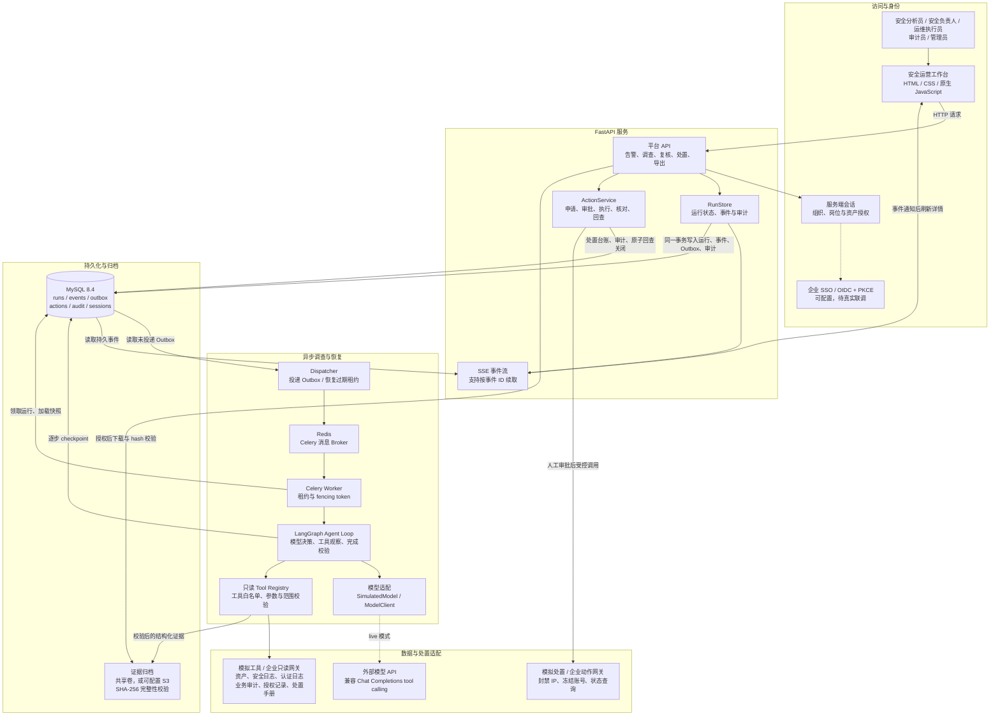
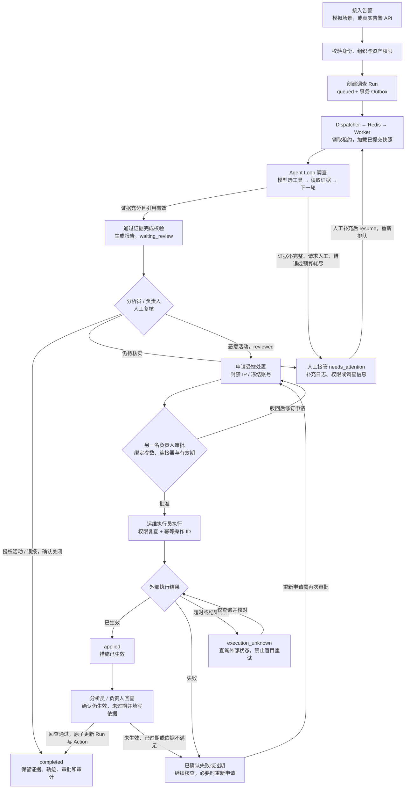
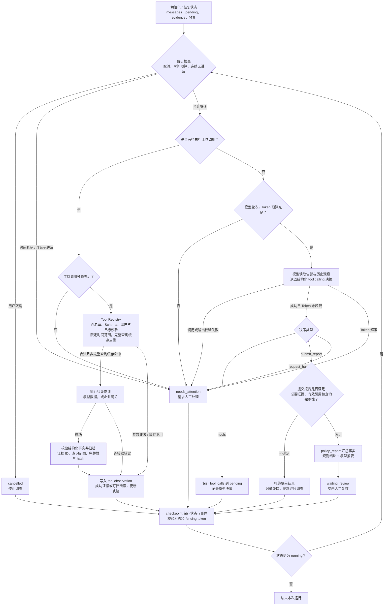

# SecOps Agent Loop 项目流程架构图

依据日期：2026-10-17。依据当前代码、Docker Compose 配置及现有测试绘制。

本文以新版平台入口 `app.platform_app:app` 为准。旧版 `app.main:app` 是固定流程 Demo，不与新版架构混用。图中的企业模型、SSO、企业网关和 S3 表示已实现的可配置适配能力；项目默认使用模拟模型、模拟连接器与本地证据归档，真实供应商接入仍需联调。

## 1. 整体架构图

该图采用 `compose.platform.yaml` 的 MySQL + Redis + Celery 部署方式。实线表示主要调用或数据流，虚线表示可配置外部适配。

- 调查 Agent 仅能读取证据；高风险写操作由 `ActionService` 在人工审批后发起。
- Redis 负责消息传递。运行快照、事件游标、审批与执行记录以数据库为依据。
- 本地开发也支持 `inline` 调度和 SQLite，此时由 FastAPI `BackgroundTasks` 调用同一个 `process_run()`，不经过 Dispatcher、Redis 和独立 Worker。
- `/metrics` 从数据库生成 Prometheus 格式指标；调查运行可输出 OpenTelemetry console spans。当前没有企业监控平台联调结果。

## 2. 端到端业务流程图

业务约束：

1. 分析员和负责人可以调查、复核与申请；负责人可以审批，运维执行员可以执行。申请人与审批人不能是同一身份。
2. 授权活动或误报在人工确认后可关闭；恶意事件必须经过处置回查关闭。待核实的事件转人工补充后继续调查。
3. 处置持续时间限制为 1–60 分钟，审批默认有效期为 30 分钟。审批过期或参数变化会阻止执行；可撤回尚未执行的申请后重新申请。
4. `executing`、`execution_unknown` 等尚未确认的动作不能通过撤回重放。回查失败本身不会自动改写 Action 状态，应先核对外部状态，确认失败或过期后再申请。
5. **Run 与 Action 是两套状态。** Run 在审批及执行期间仍为 `reviewed`；Action 单独经历 `pending → approved → executing → applied → verified`，回查成功时 Run 才变为 `completed`。

## 3. Agent Loop 内部流程图

以下是运行逻辑展开图。实际 LangGraph 由一个 `agent_step` 节点和条件自循环实现，并不是为每个图中方框单独定义一个 Graph Node。

- 默认预算：最多 12 轮模型决策、24 次工具调用、300 秒主动运行时间、64,000 Token；可通过服务端配置调整。
- 必要证据为 `security_logs`、`business_audit`、`authorization`；账号类告警额外要求 `auth_logs`。`asset_context` 与 `playbook` 是可选调查工具。
- 模型决定下一步查询和报告摘要；最终 `verdict`、`impact`、`defense` 由 `policy_report()` 根据已校验事实生成，仍需人工复核。
- 每步结束后重新累计主动运行时间；如果本步导致超时，即使刚生成报告也会撤销报告并转人工。快照提交失败会中断执行，旧 Worker 不能继续写入。
- 默认 `SimulatedModel` 按预设策略收集证据，用于离线验收；真实 `ModelClient` 才通过外部模型动态选择工具。真实模型故障不会自动伪装成模拟成功。

## 4. 异步可靠性与恢复

1. `RunStore.create()` 在同一数据库事务写入 Run、首条事件、Outbox 和审计，避免数据库已创建但消息未记录。
2. Dispatcher 先执行 `recover_expired()`，再投递未发布 Outbox；投递完成后标记发布。重复投递可能发生，由 Worker 领取机制保证同一时刻只有有效持有者提交。
3. `process_run()` 先领取租约，取得新的 fencing token，再加载数据库快照并检查配置指纹。
4. Agent 将模型决策和工具观察分别提交为应用级快照；Worker 中断后从最后一次成功提交处继续。已完成且已提交的相同查询可复用证据。
5. 这不代表所有外部调用 exactly-once：查询完成但快照尚未提交时中断，恢复后仍可能再次查询。处置写操作另由 Action 台账和网关 `Idempotency-Key` 管理。
6. 前端通过 SSE 接收数据库持久事件，再刷新运行详情；支持 `after` 或 `Last-Event-ID` 续取，连接期间重新检查身份与资产权限。

## 5. 图中模块与源码对应

| 图中模块 | 主要源码 | 核对重点 |
| --- | --- | --- |
| 平台入口与 API | `app/platform_app.py`、`app/platform/api.py` | 创建、恢复、复核、关闭、SSE、处置与导出路由 |
| 工作台 | `app/static/platform.html`、`app/static/platform.js` | HTTP 操作、角色入口、EventSource 和详情刷新 |
| 身份与授权 | `app/platform/sessions.py`、`app/platform/auth.py` | OIDC + PKCE、服务端会话、组织/岗位/资产权限 |
| 运行与 Outbox | `app/platform/runs.py`、`app/platform/database.py` | 事务、事件、租约、fencing token 与恢复 |
| 异步调度 | `app/platform/dispatch.py`、`app/platform/worker.py` | Outbox 投递、Redis Broker 与 Worker |
| 调查装配 | `app/platform/runtime.py` | 模型/连接器选择、配置指纹、归档与 checkpoint |
| Agent 内核 | `app/agent/loop.py`、`app/agent/model.py` | 条件循环、结构化决策、预算、完成校验和人工接管 |
| 工具与证据 | `app/agent/tools.py`、`app/agent/evidence.py` | 查询范围、事实 Schema、证据完整性与规则结论 |
| 处置与网关 | `app/platform/execution.py`、`app/platform/connectors.py` | 审批绑定、幂等执行、未知结果核对与回查关闭 |
| 归档与观测 | `app/platform/evidence.py`、`app/platform/telemetry.py` | 本地/S3 归档、hash、数据库指标与 OTel spans |
| 容器部署 | `compose.platform.yaml` | MySQL、Redis、迁移、API、Worker、Dispatcher 与共享卷 |

范围说明：当前是单个调查 Agent 的多轮工具循环；代码未使用多 Agent 协作、RAG、向量数据库或 MCP 调度。真实企业接入的验证边界见 [平台交付与验证记录](platform-verification.md)。
